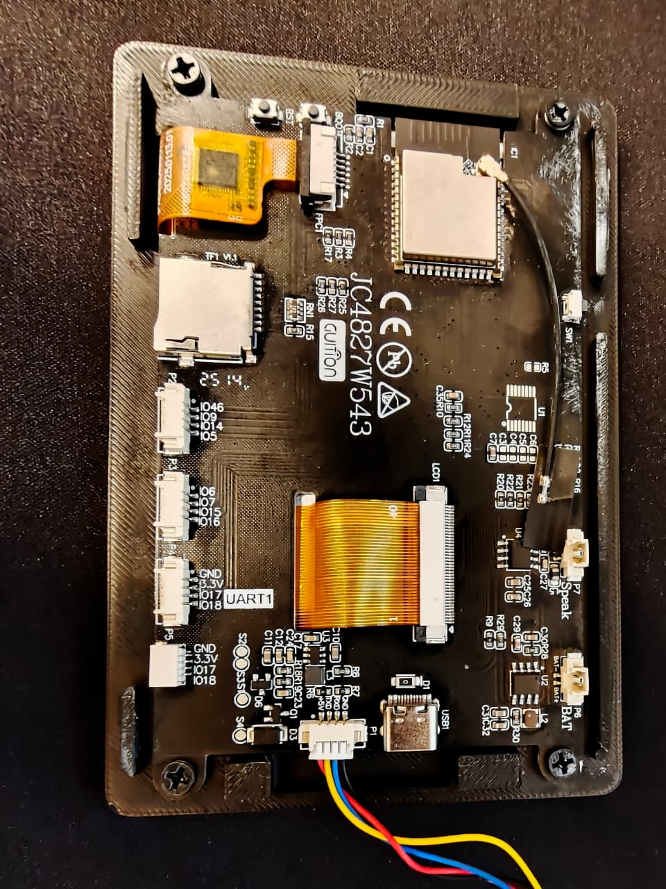
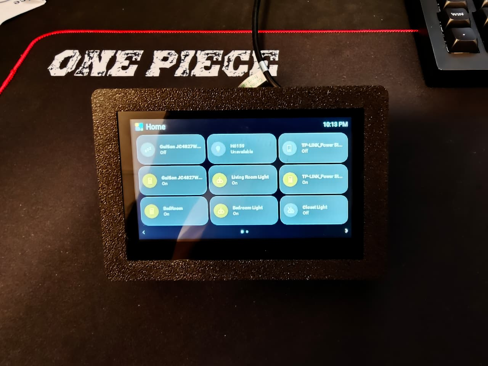

# Guition JC4827W543C, 4.3 inch, experimental

This profile is for the capacitive-touch **JC4827W543C** with an ESP32-S3-WROOM-1-N4R8,
4 MB flash, 8 MB octal PSRAM, a 480 x 272 NV3041A QSPI display and GT911 touch.
It is not for the resistive JC4827W543R, the no-touch variant, or the ESP32-P4 JC4880P443.

## Install

After this support is included in Tessera, choose **Guition, JC4827W543C** in **New screen**.
Follow [Easy setup](EASY_SETUP.md) for Wi-Fi references and unique API/OTA keys. The first
USB install uses the factory image, not the OTA-only image. Keep an existing working profile.

The remote entry is `packages/jc4827w543c.yaml`, and a build from a clone uses
`checkout/jc4827w543c.yaml`. Both include the shared core and `packages/boards/jc4827w543c.yaml`.
Until the package has been published upstream, build from a checkout containing these files;
the normal upstream package URL cannot fetch an unpublished board.

## Display, touch and layout

ESPHome's `mipi_spi` model `JC4827W543` provides the initialization, RGB order, inversion,
480 x 272 dimensions, chip select and 20 MHz QSPI clock. The board's landscape default
is 180 degrees, so the boot screen and normal UI start the same way up. Keep the screen's
Rotation setting at 0 degrees for this default; it is an additional offset, not an absolute
panel angle. An existing installation with a saved 180-degree offset must reset it to 0
when adopting this board default, otherwise it turns twice. The compact look starts with
3 columns by 3 rows in landscape and 1 by 5 in portrait. Native USB Serial/JTAG supplies logs.

The GT911's coordinates run opposite to the display on both axes. The board defaults set
`TOUCH_MIRROR_X` and `TOUCH_MIRROR_Y` to `true`, without swapping axes. The shared touch
driver applies this once; do not add another coordinate correction in the UI. A normal
screen needs no capacitive calibration or per-screen mirror override. Runtime rotation
uses the shared LVGL implementation, not another hardware transform.

## Wiring

| Function | GPIO |
| --- | --- |
| Display CS / clock | 45 / 47 |
| Display D0 / D1 / D2 / D3 | 21 / 48 / 40 / 39 |
| Backlight PWM | 1 |
| GT911 SDA / SCL | 8 / 4 |
| GT911 reset / interrupt | 38 / 3 |

The GT911 uses address `0x5D`; reset and interrupt take part in its address selection.
Brightness is PWM-controlled. No audio, SD-card or optional relay outputs are configured.

## Flash and capabilities

The wide 4 MB partition table provides two update slots of 2,031,616 bytes. Camera pictures,
media artwork and the Wi-Fi fallback hotspot are omitted to conserve flash. Changing Wi-Fi
therefore requires a new USB install if the configured network is unavailable. The bedside
clock reuses the existing digit fonts. PSRAM permits up to 128 tiles on 24 pages, subject to
the shared memory budget; it does not increase the flash available for firmware or plugins.
Check every build's size report before adding plugins or changing languages.

## Hardware acceptance

Display operation, connection to Home Assistant, firmware upload over Wi-Fi and the corrected
landscape touch mapping at absolute panel angles 0 and 180 degrees have been confirmed on a physical C panel.
The 180-degree boot default still needs a separate restart check. Keep the board experimental
until portrait touch, swipes, colour order, dimming, standby/wake and sustained operation with
a full layout have been checked separately. A successful compile is not a test of those features.

The rear silkscreen identifies the JC4827W543 family; the capacitive C variant was confirmed
for this installation. These photographs show the board and a working 3 x 3 landscape layout.

## References

- [ESPHome display support](https://github.com/esphome/esphome/pull/12034).
- [Board wiring and examples](https://github.com/profi-max/JC4827W543_4.3inch_ESP32S3_board).
