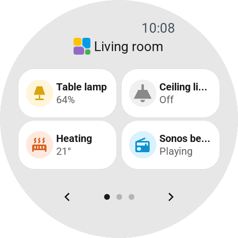
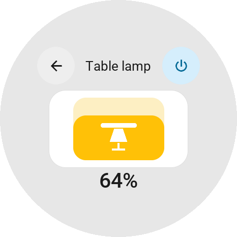
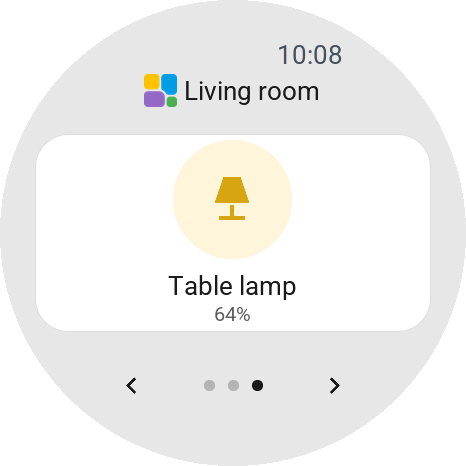
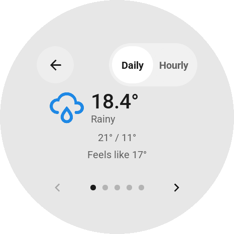
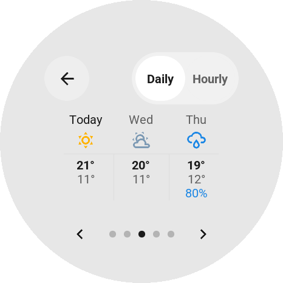
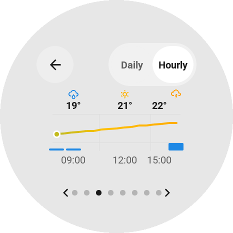
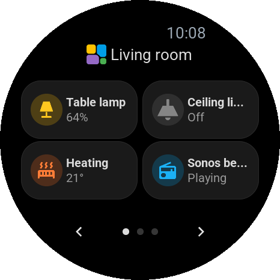

# LILYGO T-Display-S3 AMOLED 1.75

Experimental support for the **H0175Y003AM**, with a round 466 × 466 CO5300 panel and CST9217 capacitive touch.
It has an ESP32-S3, 16 MB flash and 8 MB octal PSRAM. The 1.75 inches measure the diameter, giving about 266 dpi.
This profile does not apply to LILYGO's rectangular AMOLED boards or its 1.43-inch round board.

The board has not yet passed physical acceptance. Configuration, a firmware build and native renderer tests establish
software behavior; they do not establish panel initialization, power, brightness, wake or touch alignment on the unit.

## Layout and controls

The default grid is two columns and two rows. The existing **Full** tile size gives one device the whole tile area;
**Wide** takes a row. Pages, actions, holds, Home, the Dock and the page bar use Tessera's existing routes and controls.
There is no separate round-screen layout format or device state. A tap uses the tile's normal action and a hold opens
its native card, subject to the usual availability and touch guards.

The shared circular frame puts configured status items above the smaller, centered room title. Four tiles occupy the
full safe width at their height, centered vertically on the physical display at y=233. Native overlay content uses an inscribed
square, while Back and page keys use wider safe chords.
The bounds include the complete key rectangles and a 1 mm edge margin. With this density, the native 7 mm touch minimum
is 74 pixels; a default tile is 194 × 97 pixels. A decorative badge may be smaller, since the entire tile is the
touch target. Icons keep the native visible-ink centering. Long names keep native dots. A Full card shrinks its decorative badge before its text can leave the card; inline controls that do not fit remain available in the native detail card.

The light card pages its existing colour, white-temperature and brightness rows when they cannot fit together. Preset keys get further native pages, keeping every configured preset reachable.
The weather card pages current conditions, available attributes, all supplied forecast days and up to 48 forecast hours, and keeps the native
Daily/Hourly key and forecast chart. Each uses the same native chevrons and dots as other paged cards.

The native entity catalogue and board capability gates still apply. This S3/QSPI profile does not add a speaker,
microphone, direct-glass motion or the P4 live-video path. The round layout is experimental; large optional views,
keyboards and third-party plugin interfaces need their own acceptance on this small glass. This is not a claim that
every Tessera view has been physically validated.

## Mounting at 90 degrees

Tessera already offers **0°, 90°, 180° and 270°** on a square pixel canvas, including this circular panel. Under
**Screen settings → Screen → Rotation**, choose 90° or 270° to suit the mounting. The same setting is exposed as
`select.<screen>_rotation` in Home Assistant and persists across restart. LVGL rotates the content and touch together;
do not add another touch swap to the board profile. Quarter turns preserve the 466 × 466 canvas and grid.

## Building and hardware

Use `checkout/lilygo175.yaml` from a checkout following [checkout/README.md](../checkout/README.md). The remote entry is
`packages/lilygo175.yaml`. A contribution branch must be selected for both its package and its external components;
the profile is not available in released firmware until merged and released. ESPHome 2026.9.0 is required by this
experimental profile, matching the app's pinned build environment.

The board file declares hardware packages and dimensions. [hardware/lilygo175.yaml](../packages/hardware/lilygo175.yaml)
contains the hardware configuration, following the
[manufacturer's exact-model example](https://github.com/Xinyuan-LilyGO/T-Display-S3-AMOLED-1.43-1.75/blob/main/examples/Light_Sleep_Wake_Up_H0175Y003AM/Light_Sleep_Wake_Up_H0175Y003AM.ino):

| Part | Wiring |
|---|---|
| CO5300 QSPI | CLK 12, CS 10, D0/D1/D2/D3 11/13/14/15, reset 17 |
| Panel/touch power | GPIO 16, enabled before display setup |
| CST9217 | SDA 7, SCL 6, IRQ 9, address `0x5A`, ESPHome `cst9220` driver |
| Display RAM window | 466 × 466, column offset 6, row offset 0 |
| Brightness | CO5300 controller command through the existing backlight output |

The six-column offset belongs to the display RAM window. It is not a touch calibration offset.

On the actual unit, verify USB startup and recovery, the full panel at all four rotations, taps and slider drags at
the edges and center, page swipes and holds, controller brightness, standby/wake, and settings after a restart.

## Reproduce the screenshots

After rebuilding the WASM renderer with `python3 web/wasm/build.py`, run:

```sh
python3 tools/render/round.py --out .esphome/render/round
```

This uses the repository's `diagnostics/send_layout.py` mock devices and the real firmware renderer. The colour-card
coverage shares the existing Desk/Hall fixtures with `web/wasm/test_colour_card.mjs`. Images retain the native
466 × 466 pixels; only the unlit corners are made transparent. They are simulated firmware output, not photographs.








