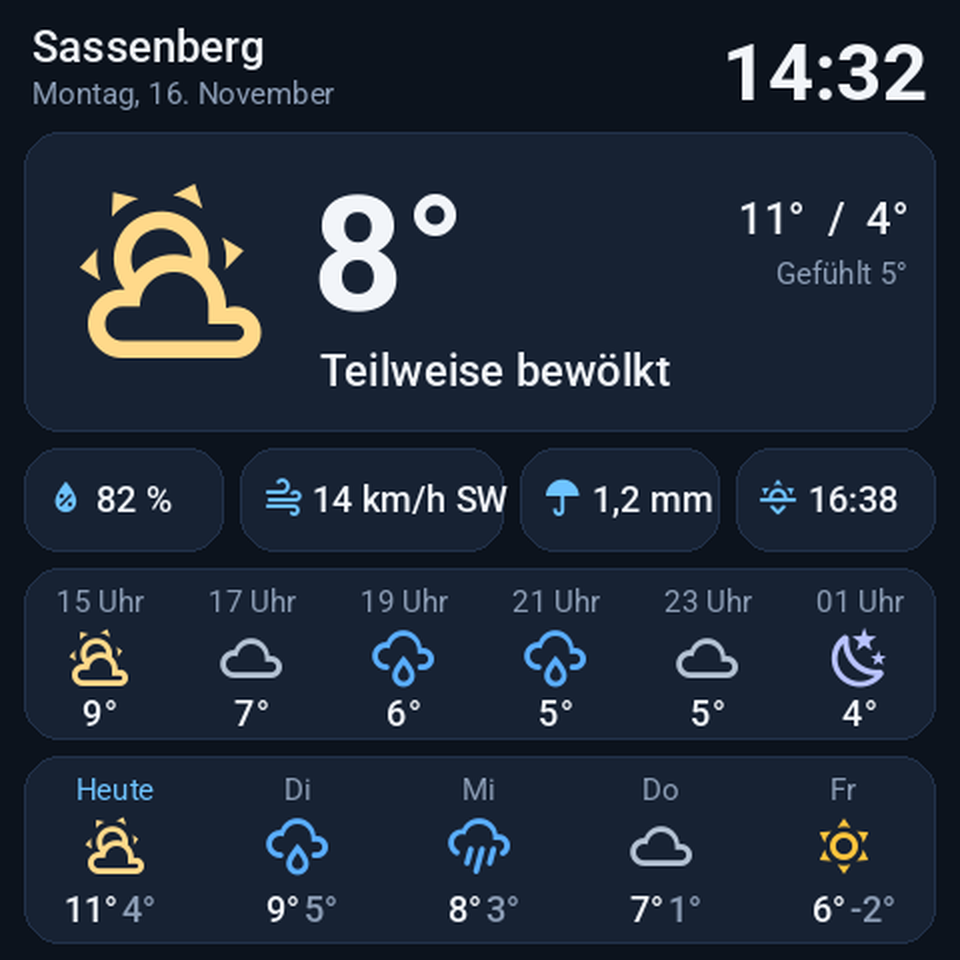

# Wetter-Display (eigenes ESPHome-Dashboard)

Ein eigenständiges Dashboard für das **Guition ESP32-S3-4848S040** (4 Zoll, 480 × 480, Touch), direkt mit ESPHome
und LVGL gebaut. Es braucht weder Tessera noch das ESP-Screen-Manager-Add-on. Die Seite zeigt das Wetter für einen
Ort: das aktuelle Wetter, die nächsten 12 Stunden und die nächsten 5 Tage.



*Die Vorschau ist mit Beispieldaten am PC gezeichnet. Auf dem Display rendert LVGL, das kann um wenige Pixel abweichen.*

## Dateien

| Datei | Wofür |
|---|---|
| `wetter-display.yaml` | die ESPHome-Konfiguration: Hardware, Schriften, Daten aus Home Assistant, Oberfläche |
| `wetter.h` | kleine C++-Hilfen: Zustand → Icon, Farbe und deutscher Text, Datum, Wind, Regen |
| `fonts/` | Roboto und Material Design Icons (Lizenzen liegen bei), damit beim Bauen nichts heruntergeladen wird |
| `home-assistant/wetter_display.yaml` | Template-Sensor für Home Assistant, der die Vorhersage für das Display aufbereitet |
| `secrets.example.yaml` | Vorlage für WLAN und Schlüssel |

## Einrichtung

### 1. Home Assistant: Vorhersage-Sensor

Seit Home Assistant 2024.4 steht die Vorhersage nicht mehr in den Attributen der Wetter-Entität. Der Sensor in
`home-assistant/wetter_display.yaml` fragt sie alle 15 Minuten mit `weather.get_forecasts` ab und legt sie als
kurze Texte in seine Attribute.

1. In `configuration.yaml` Pakete einschalten, falls noch nicht geschehen:
   ```yaml
   homeassistant:
     packages: !include_dir_named packages
   ```
2. `home-assistant/wetter_display.yaml` nach `config/packages/wetter_display.yaml` kopieren.
3. In der Datei bei `wetter:` deine Wetter-Entität eintragen. Standard ist `weather.forecast_home`, die
   Met.no-Entität für den Heimstandort.
4. Home Assistant neu starten. Danach gibt es `sensor.display_wetter` mit den Attributen `tag_0` bis `tag_4`,
   `stunde_0` bis `stunde_5` und `sonne`. Unter Entwicklerwerkzeuge → Zustände kannst du sie prüfen.

**Sassenberg statt Heimstandort:** Falls dein Zuhause in Home Assistant nicht in Sassenberg liegt, füge unter
Einstellungen → Geräte & Dienste → Integration hinzufügen → „Meteorologisk institutt (Met.no)“ einen Standort mit
Breite 51,99 und Länge 8,04 hinzu. Trag die neue Wetter-Entität dann im Paket (`wetter:`) und in
`wetter-display.yaml` (`wetter_entity:`) ein.

**Regen:** Met.no liefert die Regenmenge in mm, keine Wahrscheinlichkeit. Das Display zeigt dann mm. Mit einem
Dienst, der eine Wahrscheinlichkeit liefert (z. B. Deutscher Wetterdienst), zeigt es Prozent.

### 2. ESPHome: Display bauen und flashen

1. Den ganzen Ordner `eigenes-dashboard/` in deinen ESPHome-Konfigurationsordner kopieren (in Home Assistant meist
   `config/esphome/`). Die Dateien `wetter.h` und `fonts/` müssen neben `wetter-display.yaml` liegen.
2. Die Einträge aus `secrets.example.yaml` in die `secrets.yaml` von ESPHome übernehmen und eigene Werte eintragen.
3. Oben in `wetter-display.yaml` bei Bedarf `ort`, `wetter_entity` und `vorhersage_entity` anpassen.
4. Das erste Mal per USB-C flashen (ESPHome-Dashboard → Install → Plug into this computer). Danach geht es per WLAN.
5. Home Assistant findet das Gerät „Wetter-Display“. Beim Hinzufügen den API-Schlüssel aus `secrets.yaml` angeben.

Die Konfiguration verlangt ESPHome 2026.6.2 oder neuer. Geprüft ist sie mit `esphome config` unter ESPHome 2026.10.2;
auf echter Hardware ist sie noch nicht gelaufen.

## Was das Display zeigt

- **Kopfzeile:** Ort, Wochentag und Datum auf Deutsch, Uhrzeit (von Home Assistant)
- **Jetzt:** großes farbiges Wetter-Icon, Temperatur, Zustand, heutiges Hoch/Tief, gefühlte Temperatur (wenn der
  Dienst sie liefert)
- **Vier Kacheln:** Luftfeuchte, Wind mit Richtung, Regen heute, nächster Sonnenauf- bzw. -untergang
- **Stunden:** die nächsten 12 Stunden in 2-Stunden-Schritten
- **Tage:** heute und die nächsten 4 Tage mit Hoch und Tief

## Anpassen

- **Helligkeit:** Das Gerät bringt in Home Assistant das Licht „Hintergrundlicht“ mit. Damit kannst du z. B. nachts
  per Automation dimmen.
- **Farben:** stehen in `wetter-display.yaml` (Hintergrund `0x0C131D`, Karten `0x172233`); die Icon-Farben je Wetter
  in `wetter.h`, Funktion `color()`.
- **Fiepen:** Manche Boards fiepen bei 150 Hz PWM. Dann unter `output:` `frequency: 20kHz` setzen. Bei einigen
  Chargen wird es damit allerdings in niedrigen Stufen dunkel.
- **Weitere Seiten** (Licht, Heizung …) kommen unter `lvgl: pages:` dazu; zwischen Seiten wechselt man z. B. per
  Wischgeste oder Knopf.
