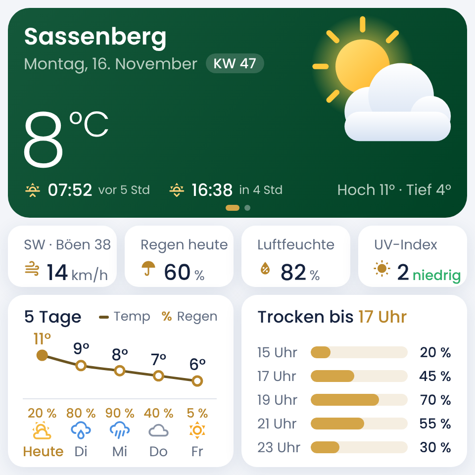
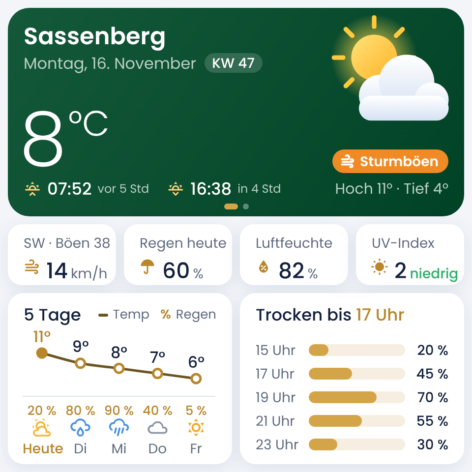
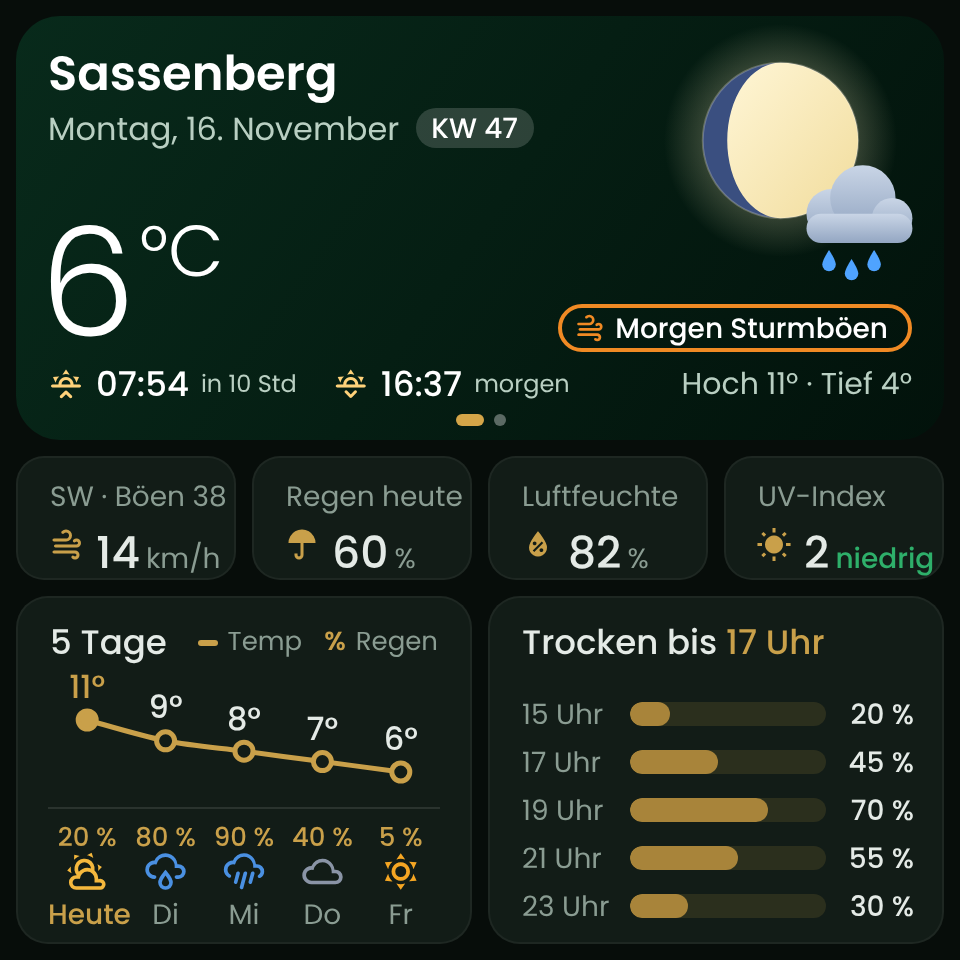

# Wetter-Display (eigenes ESPHome-Dashboard)

Ein eigenständiges Dashboard für das **Guition ESP32-S3-4848S040** (4 Zoll, 480 × 480, Touch), direkt mit ESPHome
und LVGL gebaut. Es braucht weder Tessera noch das ESP-Screen-Manager-Add-on. Es hat zwei Seiten, Wetter und
Raumklima, und wechselt alle 45 Sekunden zwischen ihnen (Regler „Seitenwechsel“ in Home Assistant). Die Seite
Raumklima erscheint erst, wenn mindestens ein Luftsensor einen CO₂-Wert liefert; bis dahin bleibt das Wetter stehen.
Zwei Punkte unten im grünen Panel zeigen, auf welcher Seite du bist.

**Bedienung:**

- **Tippen**: sofort die nächste Seite; die 45 Sekunden beginnen neu.
- **Lange drücken** (knapp 1 Sekunde): Die Seite bleibt stehen, in der Mitte erscheint für ein paar Sekunden ein
  goldenes Schloss. Bei jeder Berührung einer gehaltenen Seite erscheint es kurz wieder; ein Tippen wechselt dann
  nicht. Nur ein erneuter langer Druck gibt die Seite frei.
- **Wischen nach oben/unten**: heller/dunkler in 20-%-Schritten (10 bis 100 %); bleibt nach einem Neustart erhalten
  und steht auch im Regler „Helligkeit“ in Home Assistant.
- **Nachtmodus**: Der Schalter „Nachtmodus“ des Geräts in Home Assistant schaltet das Licht aus. Eine Berührung weckt
  das Display dann für 10 Minuten (Regler „Weckdauer im Nachtmodus“), jede weitere Berührung startet die Zeit neu. Wann es Nacht ist,
  bestimmt eine Automation in Home Assistant (Beispiel in `home-assistant/wetter_display.yaml`, dort Zeiten, Anwesenheit
  oder Sonnenstand eintragen).

 
 

*Die Bilder sind die abgestimmten Entwürfe (im Browser gezeichnet, mit Beispieldaten). Auf dem Display zeichnet LVGL,
das kann um wenige Pixel abweichen.*

## Was das Display zeigt

- **Panel oben** (British Racing Green, Akzente in Gold): Ort, Datum und Kalenderwoche, die Temperatur, Sonnenaufgang
  und -untergang mit „vor/in … Std“, ein großes Wetterbild, Hoch und Tief von heute.
- **Tag und Nacht**: Nach Sonnenuntergang wird das ganze Display dunkel (dunkle Karten, gedämpftes Gold), und das große
  Bild zeigt die Mondphase (8 Stufen, auf dem Display berechnet) mit dem aktuellen Wetter klein daneben, z. B. einer
  Regenwolke. 30 Minuten vor Sonnenaufgang wird es wieder hell und zeigt das Wetter bei Tag.
- **Warnungen des DWD**: Das Wetterbild wird kleiner, und darunter erscheint ein Hinweis in der Farbe der Warnstufe:
  1 gelb, 2 orange, 3 rot, 4 violett. Bei mehreren Warnungen bestimmt die höchste Farbe und Icon, im Hinweis stehen
  alle (die höchste zuerst); passen sie nicht hinein, laufen sie als Lauftext durch. Gibt es keine Warnung, aber eine
  **Vorwarnung**, steht sie an derselben Stelle nur mit farbigem Rand, z. B. „Morgen Sturmböen“.
- **Vier Kacheln**: Wind mit Richtung und Böen, Regen heute, Luftfeuchte, UV-Index von OpenUV mit Einstufung (niedrig
  bis extrem; nachts 0).
- **5 Tage**: Kurve der Tageshöchstwerte, darunter Regen, Wetter-Icon und Tag. Liegt das Tief eines Tages unter 0 °,
  sitzt ein kleiner Eiskristall am Icon (Frost).
- **Regen**: oben ein Satz wie „Trocken bis 17 Uhr“, „Regen bis 21 Uhr“ oder „Kein Regen in Sicht“ (als Regen zählt
  eine Stunde ab 60 % Wahrscheinlichkeit, in den nächsten 12 Stunden), darunter die nächsten 10 Stunden in
  2-Stunden-Schritten als Balken.
- **Keine Verbindung**: Fehlt die Verbindung zu Home Assistant länger als eine Minute, werden die Werte blass, und
  unten im Panel steht statt der Seitenpunkte eine durchgestrichene Wolke mit der Uhrzeit, seit der sie fehlt. Das
  Display startet deswegen nicht neu.

Regen erscheint in Prozent, wenn der Wetterdienst eine Wahrscheinlichkeit liefert (DWD), sonst in Millimetern
(Met.no); die Balken zeigen dann die Menge (4 mm = voll).

### Seite 2: Raumklima

Für drei Luftsensoren (Wohnzimmer, Schlafzimmer, Büro; SHT45 und SCD41, im Büro zusätzlich ein SEN55):

- **Panel**: CO₂ je Raum mit einer Farbskala von 400 bis 2000 ppm darunter; der Punkt auf der Skala hat die Farbe
  der Stufe. Neben dem Raumnamen zeigt ein Pfeil den Trend der letzten 15 Minuten: ↑ orange steigt, ↓ grün fällt,
  → stabil (weniger als 50 ppm Unterschied). Ab „Mittel“ (lüften empfohlen) liegt die Zahl des Raums in einem Block in der Farbe der Stufe: gelb bei
  „Mittel“, rot bei „Schlecht“.
- **Kacheln**: Temperatur und Luftfeuchte je Raum; die Luftfeuchte in Ampelfarbe.
- **Feinstaub (Büro)**: PM1, PM2.5, PM4, PM10 als Balken in Ampelfarbe.
- **Gase (Büro)**: VOC- und NOx-Index mit Einstufung.

| Wert | grün | gelb/orange | rot |
|---|---|---|---|
| CO₂ (ppm, Skala nach ELV) | Hervorragend unter 650, Gut unter 850, Befriedigend unter 1050 | Mittel unter 1550 (Lüften empfohlen) | Schlecht ab 1550 (Lüften erforderlich) |
| Luftfeuchte (Umweltbundesamt) | 40 bis 60 % | 30 bis 40 und 60 bis 70 % | unter 30 oder über 70 % |
| PM1 und PM2.5 (µg/m³, WHO) | bis 15 | bis 25 | darüber |
| PM4 und PM10 (µg/m³) | bis 45 | bis 80 | darüber |
| VOC-Index (Sensirion) | bis 150 | bis 250 | darüber |
| NOx-Index (Sensirion) | bis 20 | bis 150 | darüber |

Die Entitäten der Sensoren stehen als Platzhalter oben in `wetter-display.yaml` (`co2_wohnzimmer`,
`temp_wohnzimmer`, ..., `voc_buero`, `nox_buero`). Sobald die Sensoren in Home Assistant sind, dort ihre echten
Namen eintragen. Fehlt ein einzelner Sensor, zeigt das Display „--“.

## Dateien

| Datei | Wofür |
|---|---|
| `wetter-display.yaml` | die ESPHome-Konfiguration (geschrieben von `werkzeuge/yaml_bauen.py`) |
| `wetter.h` | C++-Hilfen: Texte, Kalenderwoche, Mondphase, Sonnenzeiten, Kurve, UV- und Warnfarben |
| `bilder/` | die Wetterbilder als PNG, dazu ihre SVG-Quellen (geschrieben von `werkzeuge/bilder.py`) |
| `fonts/` | Poppins und Material Design Icons (Lizenzen liegen bei) |
| `home-assistant/wetter_display.yaml` | Template-Sensor für Home Assistant: Vorhersage, Sonne, Warnungen |
| `werkzeuge/` | die beiden Generatoren und der Hardware-Teil der Konfiguration |
| `secrets.example.yaml` | Vorlage für WLAN und Schlüssel |

## Einrichtung

### 1. Home Assistant: Wetterdienst und Warnungen

1. **Vorhersage vom DWD**: die Integration „DWD Weather“ über HACS installieren und die nächstgelegene Station
   wählen. Sie legt eine Wetter-Entität an (z. B. `weather.<station>`). Met.no geht auch, dann ohne
   Regenwahrscheinlichkeit. Die Option „Erzwinge die stündliche Aktualisierung“ der DWD-Integration ausgeschaltet
   lassen: Mit ihr fehlt die Regenwahrscheinlichkeit, und das Display zeigt Regen in Millimetern.
2. **UV-Index von OpenUV**: auf openuv.io kostenlos registrieren und den API-Schlüssel kopieren. Unter
   Einstellungen → Geräte & Dienste → Integration hinzufügen → „OpenUV“ den Schlüssel eintragen. Gebraucht wird die
   Entität „Aktueller UV-Index“. Das Paket unten enthält eine Automation, die sie tagsüber alle 30 Minuten abfragt
   (der kostenlose Schlüssel erlaubt 50 Abfragen am Tag).
3. **Warnungen vom DWD**: unter Einstellungen → Geräte & Dienste → Integration hinzufügen → „Deutscher Wetterdienst
   (DWD) Weather Warnings“ den Warnbereich eintragen (für Sassenberg der Kreis Warendorf). Gebraucht wird der Sensor
   der *aktuellen* Warnstufe und der der *Vorwarnstufe*.
4. In `configuration.yaml` Pakete einschalten, falls noch nicht geschehen:
   ```yaml
   homeassistant:
     packages: !include_dir_named packages
   ```
5. `home-assistant/wetter_display.yaml` nach `config/packages/wetter_display.yaml` kopieren und darin die Zeilen
   `wetter:`, `warnungen:` und `vorwarnungen:` auf deine Entitäten setzen (die beiden Warn-Entitäten stehen außerdem
   bei den Auslösern oben); ganz unten in den Automationen die OpenUV-Entität und den Schalter für den Nachtmodus.
6. Home Assistant neu starten. Danach gibt es `sensor.display_wetter` mit den Attributen `tag_0` bis `tag_4`,
   `stunde_0` bis `stunde_4`, `sonne`, `warnung`, `vorwarnung` und `regen_satz` (Entwicklerwerkzeuge → Zustände).

### 2. ESPHome: Display bauen und flashen

1. Den **Inhalt** von `eigenes-dashboard/` (`wetter-display.yaml`, `wetter.h`, `bilder/`, `fonts/`) direkt nach
   `config/esphome/` kopieren, z. B. mit dem Samba- oder dem Studio-Code-Server-Add-on. Das ESPHome-Dashboard zeigt
   nur YAML-Dateien, die direkt in diesem Ordner liegen, keine aus Unterordnern.
2. Die Einträge aus `secrets.example.yaml` in `config/esphome/secrets.yaml` übernehmen und eigene Werte eintragen.
3. Oben in `wetter-display.yaml` `ort`, `wetter_entity` (dieselbe Wetter-Entität wie im Paket), `uv_entity` (OpenUV) und
   `vorhersage_entity` anpassen.
4. Das erste Mal per USB-C flashen, danach geht es per WLAN. Läuft Home Assistant in einer VM (z. B. unter Proxmox),
   ist der einfachste Weg: im ESPHome-Dashboard bei „Wetter-Display“ ⋮ → Install → Manual download → „Factory
   format“ wählen, die `.bin` herunterladen und am eigenen PC in Chrome oder Edge auf https://web.esphome.io mit
   dem per USB angesteckten Display flashen. Den USB-Anschluss an die VM durchzureichen geht auch, ist aber
   umständlicher.
5. Home Assistant findet das Gerät „Wetter-Display“ (Einstellungen → Geräte & Dienste). Beim Hinzufügen den
   API-Schlüssel aus `secrets.yaml` angeben. Das Display liest nur Zustände; die Option, Aktionen ausführen zu dürfen,
   braucht es nicht.

Der erste Build dauert in der VM 10 bis 20 Minuten und braucht Arbeitsspeicher: Gib der VM mindestens 4 GB.

Die Konfiguration verlangt ESPHome 2026.6.2 oder neuer.

## Anpassen

- **Aufbau, Farben, Größen**: in `werkzeuge/yaml_bauen.py` ändern und `python3 werkzeuge/yaml_bauen.py` ausführen;
  es schreibt `wetter-display.yaml` neu.
- **Wetterbilder**: in `werkzeuge/bilder.py` zeichnen und `python3 werkzeuge/bilder.py` ausführen (braucht
  `pip install cairosvg`).
- **In Home Assistant** (Gerät „Wetter-Display“): die Regler „Seitenwechsel“ (Sekunden), „Weckdauer im Nachtmodus“
  (Minuten) und „Helligkeit“, der Schalter „Nachtmodus“, unter Diagnose „WLAN-Signal“ und „Laufzeit“ sowie der Knopf
  „Neustart“. `seitenwechsel` und `weckdauer` oben in `wetter-display.yaml` sind nur die Startwerte.
- **Fiepen**: Manche Boards fiepen bei 150 Hz PWM. Dann in `werkzeuge/hardware.yaml` `frequency: 20kHz` setzen; bei
  einigen Chargen wird es damit in niedrigen Stufen dunkel.

## Stand der Prüfung

- `esphome config` und `esphome compile` laufen fehlerfrei, mit beiden Seiten (ESPHome 2026.10.2; Firmware rund 3,3 MB, 41 % der
  App-Partition).
- `wetter.h` ist mit einem Test auf dem PC geprüft: Kalenderwoche (auch an Jahreswechseln mit 53 Wochen), Mondphase,
  Sonnenzeiten, Regenwerte, Kurve, Warn-Icons.
- Die Vorlagen des Home-Assistant-Pakets sind mit Beispieldaten durchgerechnet, auch nachts, ohne Stundenvorhersage
  und ohne Warnung; Regensatz und Vorwarnung mit trockenen, nassen und gemischten Stunden.
- Die Stufen der Raumklima-Seite sind an allen Grenzwerten getestet.
- Auf dem echten Display laufen Wetterseite, Warnungen, Gesten und Nachtmodus. **Noch nicht auf dem Display
  geprüft**: dunkles Design, Vorwarnung, Regensatz, Böen, Frost, Seitenpunkte, die Anzeige ohne Verbindung, der
  CO₂-Trend und die Regler. Die Luftsensoren sind Platzhalter, bis sie in Home Assistant eingerichtet sind.
