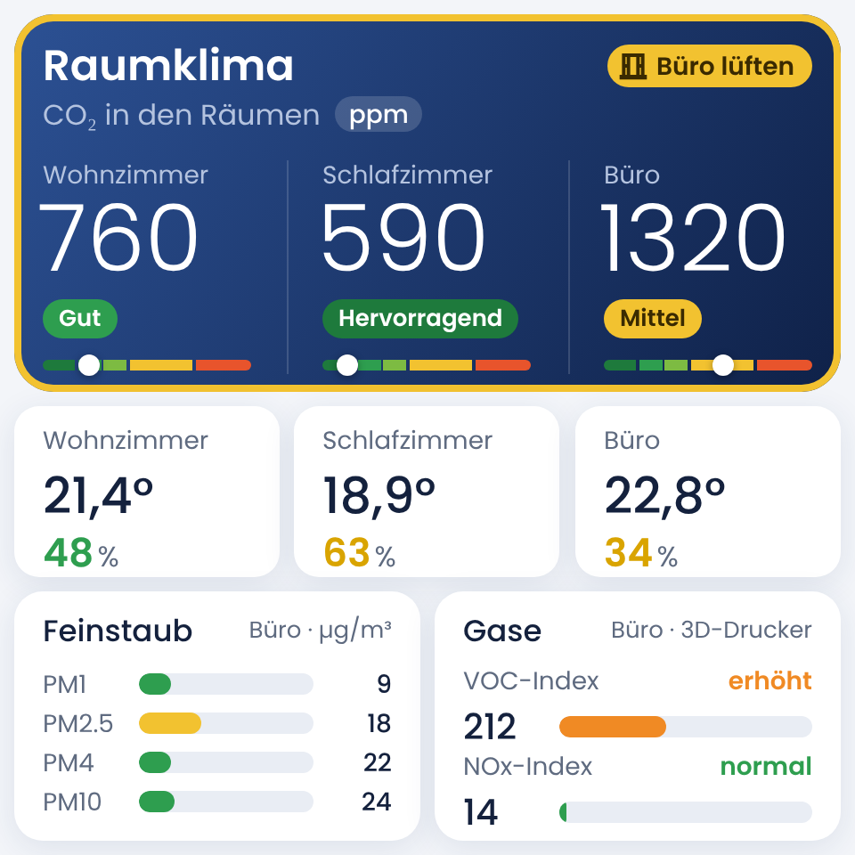

# Wetter-Display (eigenes ESPHome-Dashboard)

Ein eigenständiges Dashboard für das **Guition ESP32-S3-4848S040** (4 Zoll, 480 × 480, Touch), direkt mit ESPHome
und LVGL gebaut. Es braucht weder Tessera noch das ESP-Screen-Manager-Add-on. Es hat zwei Seiten, Wetter und
Raumklima, und wechselt alle 45 Sekunden zwischen ihnen (`seitenwechsel` oben in `wetter-display.yaml`).

 


*Die Bilder sind die abgestimmten Entwürfe (im Browser gezeichnet, mit Beispieldaten). Auf dem Display zeichnet LVGL,
das kann um wenige Pixel abweichen.*

## Was das Display zeigt

- **Panel oben** (tagsüber blau, nachts dunkler): Ort, Datum und Kalenderwoche, die Temperatur, Sonnenaufgang und
  -untergang mit „vor/in … Std“, ein großes Wetterbild, der Wettertext, Hoch und Tief von heute.
- **Nachts** zeigt das große Bild die Mondphase (8 Stufen, auf dem Display berechnet) und klein daneben das aktuelle
  Wetter, z. B. eine Regenwolke.
- **Warnungen des DWD**: ein Rahmen um das Panel und ein Hinweis neben dem Ort, in der Farbe der Warnstufe:
  1 gelb, 2 orange, 3 rot, 4 violett. Bei mehreren Warnungen zählt die höchste.
- **Vier Kacheln**: Wind mit Richtung, Regen heute, Luftfeuchte, UV-Index mit Einstufung (niedrig bis extrem).
- **5 Tage**: Kurve der Tageshöchstwerte, darunter Regen, Wetter-Icon und Tag.
- **Regen**: die nächsten 10 Stunden in 2-Stunden-Schritten als Balken.

Regen erscheint in Prozent, wenn der Wetterdienst eine Wahrscheinlichkeit liefert (DWD), sonst in Millimetern
(Met.no); die Balken zeigen dann die Menge (4 mm = voll).

### Seite 2: Raumklima

Für drei Luftsensoren (Wohnzimmer, Schlafzimmer, Büro; SHT45 und SCD41, im Büro zusätzlich ein SEN55):

- **Panel**: CO₂ je Raum mit Einstufung und Farbskala von 400 bis 2000 ppm. Ab „Mittel“ erscheinen rechts oben ein
  Hinweis „<Raum> lüften“ und ein Rahmen in der Farbe der Stufe (der Raum mit dem meisten CO₂ zählt).
- **Kacheln**: Temperatur und Luftfeuchte je Raum; die Luftfeuchte in Ampelfarbe.
- **Feinstaub (Büro)**: PM1, PM2.5, PM4, PM10 als Balken in Ampelfarbe.
- **Gase (Büro)**: VOC- und NOx-Index mit Einstufung.

| Wert | grün | gelb/orange | rot |
|---|---|---|---|
| CO₂ (ppm, Skala nach ELV) | Hervorragend unter 650, Gut unter 850, Befriedigend unter 1050 | Mittel unter 1550 (Lüften empfohlen) | Schlecht ab 1550 (Lüften erforderlich) |
| Luftfeuchte (Umweltbundesamt) | 40 bis 60 % | 30 bis 40 und 60 bis 70 % | unter 30 oder über 70 % |
| PM1 und PM2.5 (µg/m³, WHO) | bis 15 | bis 25 | darüber |
| PM4 und PM10 (µg/m³) | bis 45 | bis 80 | darüber |
| VOC-Index (Sensirion) | bis 150 | bis 250 | darüber |
| NOx-Index (Sensirion) | bis 20 | bis 150 | darüber |

Die Entitäten der Sensoren stehen als Platzhalter oben in `wetter-display.yaml` (`co2_wohnzimmer`,
`temp_wohnzimmer`, ..., `voc_buero`, `nox_buero`). Sobald die Sensoren in Home Assistant sind, dort ihre echten
Namen eintragen. Fehlt ein Sensor, zeigt das Display „--“.

## Dateien

| Datei | Wofür |
|---|---|
| `wetter-display.yaml` | die ESPHome-Konfiguration (geschrieben von `werkzeuge/yaml_bauen.py`) |
| `wetter.h` | C++-Hilfen: Texte, Kalenderwoche, Mondphase, Sonnenzeiten, Kurve, UV- und Warnfarben |
| `bilder/` | die Wetterbilder als PNG, dazu ihre SVG-Quellen (geschrieben von `werkzeuge/bilder.py`) |
| `fonts/` | Poppins und Material Design Icons (Lizenzen liegen bei) |
| `home-assistant/wetter_display.yaml` | Template-Sensor für Home Assistant: Vorhersage, Sonne, Warnungen |
| `werkzeuge/` | die beiden Generatoren und der Hardware-Teil der Konfiguration |
| `secrets.example.yaml` | Vorlage für WLAN und Schlüssel |

## Einrichtung

### 1. Home Assistant: Wetterdienst und Warnungen

1. **Vorhersage vom DWD**: die Integration „DWD Weather“ über HACS installieren und die nächstgelegene Station
   wählen. Sie legt eine Wetter-Entität an (z. B. `weather.<station>`). Met.no geht auch, dann ohne
   Regenwahrscheinlichkeit.
2. **Warnungen vom DWD**: unter Einstellungen → Geräte & Dienste → Integration hinzufügen → „Deutscher Wetterdienst
   (DWD) Weather Warnings“ den Warnbereich eintragen (für Sassenberg der Kreis Warendorf). Gebraucht wird der Sensor
   der *aktuellen* Warnstufe.
3. In `configuration.yaml` Pakete einschalten, falls noch nicht geschehen:
   ```yaml
   homeassistant:
     packages: !include_dir_named packages
   ```
4. `home-assistant/wetter_display.yaml` nach `config/packages/wetter_display.yaml` kopieren und darin die beiden
   Zeilen `wetter:` und `warnungen:` auf deine Entitäten setzen (die Warnungs-Entität steht außerdem einmal bei den
   Auslösern oben).
5. Home Assistant neu starten. Danach gibt es `sensor.display_wetter` mit den Attributen `tag_0` bis `tag_4`,
   `stunde_0` bis `stunde_4`, `sonne` und `warnung` (Entwicklerwerkzeuge → Zustände).

### 2. ESPHome: Display bauen und flashen

1. Den ganzen Ordner `eigenes-dashboard/` in deinen ESPHome-Konfigurationsordner kopieren (in Home Assistant meist
   `config/esphome/`). `wetter.h`, `bilder/` und `fonts/` müssen neben `wetter-display.yaml` liegen.
2. Die Einträge aus `secrets.example.yaml` in die `secrets.yaml` von ESPHome übernehmen und eigene Werte eintragen.
3. Oben in `wetter-display.yaml` `ort`, `wetter_entity` (dieselbe Wetter-Entität wie im Paket) und
   `vorhersage_entity` anpassen.
4. Das erste Mal per USB-C flashen (ESPHome-Dashboard → Install → Plug into this computer). Danach geht es per WLAN.
5. Home Assistant findet das Gerät „Wetter-Display“. Beim Hinzufügen den API-Schlüssel aus `secrets.yaml` angeben und
   unter den Geräteoptionen erlauben, dass das Gerät Home-Assistant-Daten lesen darf.

Die Konfiguration verlangt ESPHome 2026.6.2 oder neuer.

## Anpassen

- **Aufbau, Farben, Größen**: in `werkzeuge/yaml_bauen.py` ändern und `python3 werkzeuge/yaml_bauen.py` ausführen;
  es schreibt `wetter-display.yaml` neu.
- **Wetterbilder**: in `werkzeuge/bilder.py` zeichnen und `python3 werkzeuge/bilder.py` ausführen (braucht
  `pip install cairosvg`).
- **Helligkeit**: Das Gerät bringt in Home Assistant das Licht „Hintergrundlicht“ mit, z. B. für eine Automation, die
  nachts dimmt.
- **Fiepen**: Manche Boards fiepen bei 150 Hz PWM. Dann in `werkzeuge/hardware.yaml` `frequency: 20kHz` setzen; bei
  einigen Chargen wird es damit in niedrigen Stufen dunkel.

## Stand der Prüfung

- `esphome config` und `esphome compile` laufen fehlerfrei (ESPHome 2026.10.2; Firmware rund 2,9 MB, 36 % der
  App-Partition).
- `wetter.h` ist mit einem Test auf dem PC geprüft: Kalenderwoche (auch an Jahreswechseln mit 53 Wochen), Mondphase,
  Sonnenzeiten, Regenwerte, Kurve, Warn-Icons.
- Die Vorlagen des Home-Assistant-Pakets sind mit Beispieldaten durchgerechnet, auch nachts, ohne Stundenvorhersage
  und ohne Warnung.
- Die Stufen der Raumklima-Seite sind an allen Grenzwerten getestet.
- **Nicht geprüft**: auf dem echten Display ist die Firmware noch nicht gelaufen, und die Entitäten der
  DWD-Integrationen und der Luftsensoren sind Platzhalter, bis sie in deinem Home Assistant eingerichtet sind.
